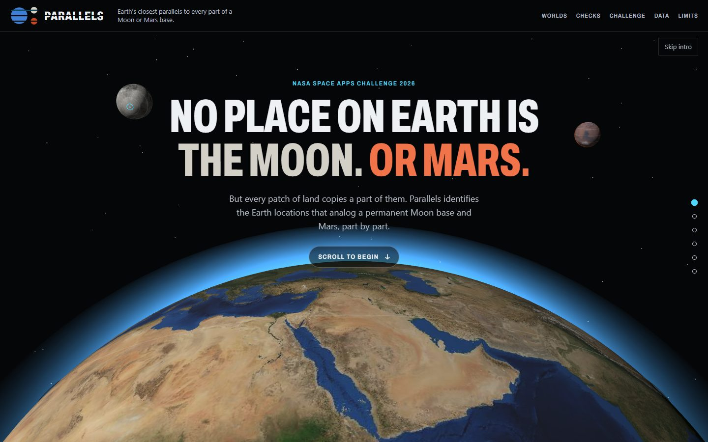
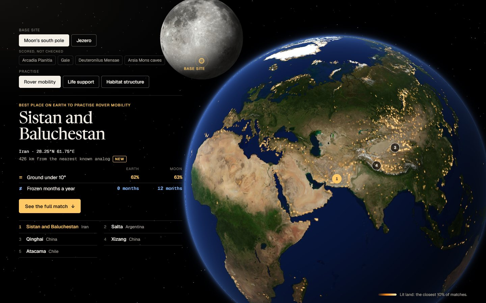
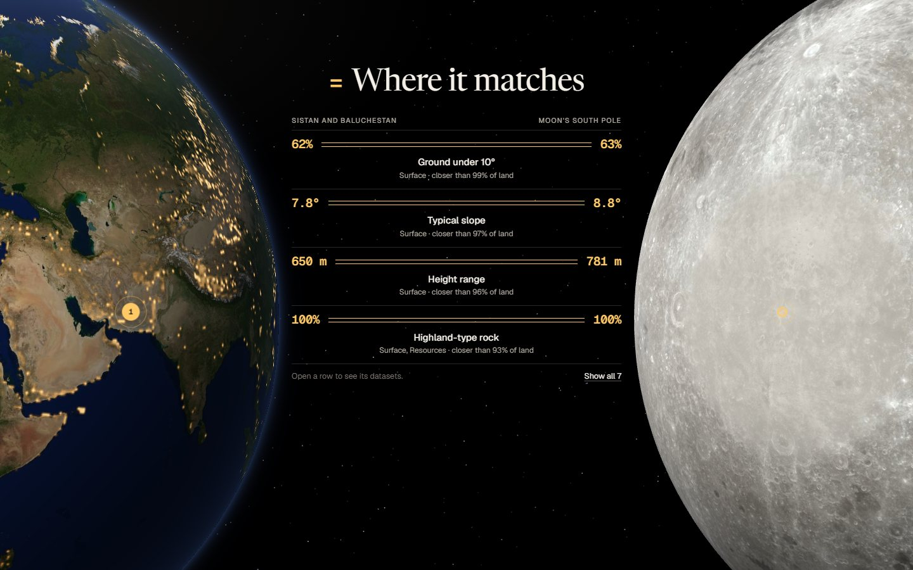
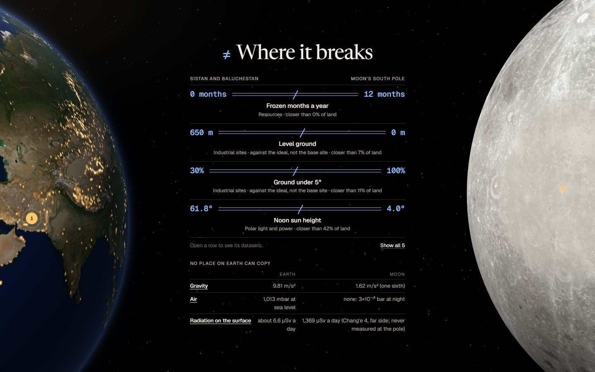
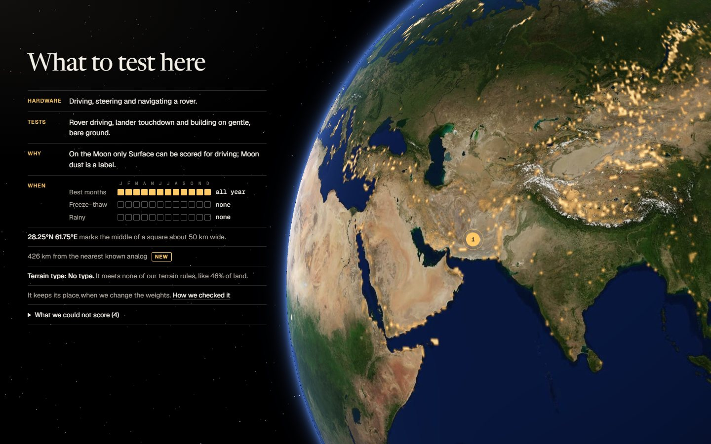
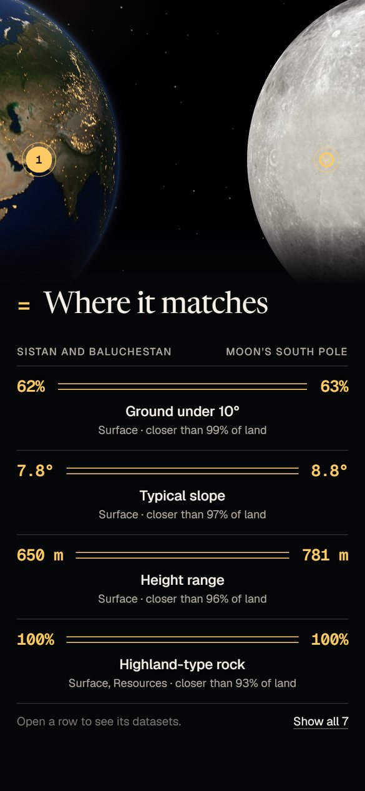

# Parallels

[](https://www.spaceappschallenge.org/)
[](https://www.spaceappschallenge.org/2026/challenges/permanent-moon-base-locations-and-mars/)
[](#team-and-credits)
[](LICENSE)

**Earth's closest parallels to every part of a Moon or Mars base.**

Our NASA Space Apps 2026 entry for [Identify Earth Locations that Analog the Permanent Moon Base Locations and Mars](https://www.spaceappschallenge.org/2026/challenges/permanent-moon-base-locations-and-mars/). Event: 14–15 November 2026.

No single place on Earth can stand in for a Moon or Mars base. So we split base-building into challenges, and for each one we rank the Earth sites best suited to test it. Parallels scores **91,971** squares of land (0.5°, about 50 km wide) against **six** Moon and Mars base sites, for **three** kinds of mission. Every match shows what is similar, how similar, and where it breaks, with the dataset behind each number. We check the method against known analog sites and publish the result, pass or fail.

**TEAM RMD** · Use of AI: [How we used AI](#how-we-used-ai)

---

## Screenshots

<table>
<tr>
<td width="50%" valign="top"><br><b>The finding in one sentence</b><br><sub>Earth's horizon with the closest matches lit, and the Moon and Mars above it.</sub></td>
<td width="50%" valign="top"><br><b>Find a place</b><br><sub>Pick a base site and a mission filter. The five best distinct places are pinned, and the best one shows one number that matches and one that breaks.</sub></td>
</tr>
<tr>
<td width="50%" valign="top"><br><b>Where it matches</b><br><sub>The Earth value against the base-site value, row by row. Each row opens to show both datasets.</sub></td>
<td width="50%" valign="top"><br><b>Where it breaks</b><br><sub>The numbers that do not match, and what no place on Earth can copy: gravity, air and radiation.</sub></td>
</tr>
<tr>
<td width="50%" valign="top"><br><b>What to test here</b><br><sub>Hardware, tests, the best months, coordinates and terrain type for the chosen place.</sub></td>
<td width="50%" valign="top"><br><b>On a phone</b><br><sub>The globes stay on top while the text scrolls under them.</sub></td>
</tr>
</table>

The screenshots show the version 2 site while it is being built (15 November 2026).

---

## Contents

1. [The problem](#the-problem)
2. [What Parallels does](#what-parallels-does)
3. [How it works](#how-it-works)
4. [Status](#status)
5. [Repository layout](#repository-layout)
6. [Quick start](#quick-start)
7. [The data files](#the-data-files)
8. [How we used AI](#how-we-used-ai)
9. [NASA and partner data sources](#nasa-and-partner-data-sources)
10. [Technology stack](#technology-stack)
11. [Scoring model](#scoring-model)
12. [Validation](#validation)
13. [Limits](#limits)
14. [Team and credits](#team-and-credits)
15. [Licence](#licence)

---

## The problem

Testing hardware on the Moon or Mars is too costly to get wrong, so space agencies test first on Earth, in places called analogs. A few famous sites are used again and again: the Atacama, Hawaii's volcanoes, Haughton Crater, Rio Tinto, Antarctica and Iceland. Thousands of other deserts, volcanic fields, salt flats, frozen basins and caves have never been compared with the same set of planetary measurements.

No place on Earth copies a base whole:

| Why | What it means |
|---|---|
| Each part of a base needs different ground | The best place to practise rover driving is not the best place to practise drilling frozen ground. |
| Earth cannot copy some things at all | Low gravity, the Moon's vacuum, Mars's thin air and space radiation. |
| Most of Earth was never checked | Lists of analog sites are short and picked by hand. |

So Parallels asks a narrower question. For each part of a base, where on Earth is the best place to practise it, and where does that match break?

---

## What Parallels does

| Capability | Description |
|---|---|
| **Base sites** | Six: the Moon's south pole (the nine Artemis III regions) and five Mars sites (Jezero, Gale, Arcadia Planitia, Deuteronilus Mensae and the Arsia Mons caves). Each value names its dataset or paper in `dataset/manifest.json`. |
| **Parts of a base** | The Moon has eight challenges and Mars has seven, such as Surface, Resources, Heat swing and Atmosphere and dust. Parts that cannot be measured on both sides are shown as labels, with the reason. |
| **Mission filters** | Rover mobility, Life support and Habitat structure. Each one weights the challenges for that kind of test. |
| **Search of all land** | Every square of land is ranked on 17 traits against all of Earth's land, not against a hand-picked list. |
| **Distinct places** | The five best places for a base site and filter, at least 300 km apart and in different regions. |
| **Match and break** | Each trait shows the Earth value against the base-site value in real units, with both datasets linked. Missing data is shown as missing. |
| **New places** | Each place shows its distance to the nearest of the 50 known analog sites in our list. The two headline places are 426 km and 595 km away. |
| **Seasons** | Best months, freeze–thaw months and rainy months for each place, and a score for year-round testing. |
| **Terrain types** | Arid basin, high-altitude volcanic field, salt flat, frozen ground, and cave or lava tube, each from a visible rule. About 46% of land meets none of the rules, and the site says so. |
| **A public check** | Known analogs must beat ordinary places and plain deserts. The rules were fixed in git before each run, and every result is published. See [Validation](#validation). |

**Design rule:** the browser computes nothing new. It selects, groups and displays what the pipeline already computed, so every number on screen traces to a named dataset.

---

## How it works

```
┌──────────────────────────────────────────────────────────────────────────┐
│ 1. BASE-SITE VALUES                                                      │
│    Moon and Mars maps (NASA PDS, NASA PGDA, USGS) and published results  │
│    → one value per trait for each of the six base sites                  │
└──────────────────────────────────────────────────────────────────────────┘
                                     ▼
┌──────────────────────────────────────────────────────────────────────────┐
│ 2. EARTH DATA LAYER (offline pipeline)                                   │
│    NASA POWER climate, Copernicus terrain, GLiM rock, NASA EMIT minerals │
│    and MODIS land cover → one 0.5° grid of 91,971 land squares           │
└──────────────────────────────────────────────────────────────────────────┘
                                     ▼
┌──────────────────────────────────────────────────────────────────────────┐
│ 3. RANKING                                                               │
│    each trait is ranked against all of Earth's land                      │
│    traits → challenges → mission filters                                 │
└──────────────────────────────────────────────────────────────────────────┘
                                     ▼
┌──────────────────────────────────────────────────────────────────────────┐
│ 4. VALIDATION                                                            │
│    known analogs against ordinary places and plain deserts,              │
│    with the rules fixed in git before each run                           │
└──────────────────────────────────────────────────────────────────────────┘
                                     ▼
┌──────────────────────────────────────────────────────────────────────────┐
│ 5. DATA FILES (dataset/)                                                 │
│    manifest.json, cells.bin, six target files, labels.json,              │
│    validation.json                                                       │
└──────────────────────────────────────────────────────────────────────────┘
                                     ▼
┌──────────────────────────────────────────────────────────────────────────┐
│ 6. STATIC SITE (site/)                                                   │
│    reads the files and computes nothing new: 3D globes,                  │
│    five distinct places, where each one matches and where it breaks      │
└──────────────────────────────────────────────────────────────────────────┘
```

---

## Status

**The data is final.** Version 1 ranks every land cell on Earth against six targets: the Moon's south pole and five Mars sites (Jezero, Gale, Arcadia Planitia, Deuteronilus Mensae and the Arsia Mons caves). The data files hold method version 1.2. Only the Moon's south pole and Jezero are checked against test places.

**The method does not pass every check.** It passes 1 of its 4 first checks. In the fourth run, 10 of 15 checks with enough sites pass. On the held-out half, version 1.2 beats ordinary places 96% of the time for the Moon and 76% for Mars. See [Validation](#validation) and `dataset/validation.json`.

**The version 2 site is being built** on the `v2` branch, from scratch.

| Part of the site | State on 15 November |
|---|---|
| Intro, "Find a place", "Where it matches", "Where it breaks", "What to test here" | Built |
| "How we checked it", "For judges", terrain filter, year-round switch | Next |
| "Build the whole base", 3D terrain close-up, Learn page | Next |
| Guided tour | Next |

The roadmap is in [docs/roadmap.md](docs/roadmap.md).

## Repository layout

- [docs/challenge-guide.pdf](docs/challenge-guide.pdf): our local event's Challenge Guide, a key brief.
- [docs/challenge.md](docs/challenge.md): the challenge in plain words, and how we meet the guide's six objectives and answer its seven questions.
- [docs/plan.md](docs/plan.md): the plan: the team's idea, and the spec for version 2.
- [docs/roadmap.md](docs/roadmap.md): what gets built when, and by whom.
- [docs/judging-notes.md](docs/judging-notes.md): how Space Apps is judged and what past winners did.
- [docs/guidelines.md](docs/guidelines.md): how we work, the official rules and our submission checklist.
- [CLAUDE.md](CLAUDE.md): instructions for Claude, our AI build assistant.
- `pipeline/`: the Python data pipeline. Its method settings are in `pipeline/config/`.
- `dataset/`: the pre-computed files the pipeline exports. See [The data files](#the-data-files).
- `site/`: the version 2 site, in progress on the `v2` branch. It reads the files in `dataset/` and changes none of them. See [The site](#the-site).

## Quick start

Pipeline (Python 3.13). Run each command from the repository root.

1. `uv sync` installs the packages into `.venv`.
2. Run the pipeline stages in this order. Raw downloads go to `data/`, which is not in git. Results go to `data/derived/`.

| Stage | Command | What it does |
|---|---|---|
| Climate | `.venv/Scripts/python -m pipeline.climate` | Reads NASA POWER climate data and Natural Earth land. Writes the 0.5 degree climate grid. |
| Terrain | `.venv/Scripts/python -m pipeline.terrain_grid` | Reads Copernicus DEM GLO-90 tiles. Writes slope and relief for each cell. Takes about 30 minutes. |
| Surface | `.venv/Scripts/python -m pipeline.surface` | Reads GLiM rock, NASA EMIT minerals and MODIS land cover. Writes the surface grid. Needs a free NASA Earthdata login in `~/.netrc`, read through `earthaccess`. Without it, EMIT minerals and every MODIS file are out. rasterio's GDAL has no HDF4 driver, so the MODIS file is read with `pyhdf`. |
| Targets | `.venv/Scripts/python -m pipeline.targets` | Reads Moon and Mars maps. Writes `pipeline/derived/targets_v1.json`. |
| Export | `.venv/Scripts/python -m pipeline.export` | Ranks the cells, runs the validation and writes the files in `dataset/`. Add `--method 1.2` to run method versions 1.1 and 1.2 as further validation runs. |

3. Run the tests: `.venv/Scripts/python -m pytest`.

On macOS and Linux, use `.venv/bin/python` in place of `.venv/Scripts/python`.

Version 1 was built with Python 3.13.17 and uv 0.13.7. Never print, copy or commit the Earthdata login.

### The site

The site is static: it has no server and no keys. Run each command from `site/` (Node 24).

| Command | What it does |
|---|---|
| `npm ci` | Installs the packages. |
| `npm run dev` | Copies `dataset/` into the site and starts it locally. |
| `npm run build` | Checks the types and builds the site into `site/dist`. |
| `npm test` | Runs the unit tests against the real data files. |
| `npm run e2e` | Runs the browser tests against the built site. |
| `node scripts/fetch-textures.mjs` | Rebuilds the globe images from their NASA sources. Run it only when the images must change. |

## The data files

The pipeline's whole output is these files in `dataset/`. `pipeline.export` writes all of them.

| File | What it holds | Size |
|---|---|---|
| `manifest.json` | The data list, traits, challenges, mission filters, terrain types, targets and their values, the byte layout of the `.bin` files, the benchmarks, the questions and the "not in this version" list | 230 KB |
| `cells.bin` | One value per land cell (91,971 cells) for each of 30 columns: position, climate, terrain, rock, minerals, terrain type and cluster | 4.4 MB |
| `target-moon-south-pole.bin` | Ranks and scores of every cell against the Moon's south pole | 3.6 MB |
| `target-mars-jezero.bin` | The same, against Jezero | 3.6 MB |
| `target-mars-gale.bin` | The same, against Gale | 3.3 MB |
| `target-mars-arcadia-planitia.bin` | The same, against Arcadia Planitia | 2.8 MB |
| `target-mars-deuteronilus-mensae.bin` | The same, against Deuteronilus Mensae | 2.8 MB |
| `target-mars-arsia-mons-caves.bin` | The same, against the Arsia Mons caves | 2.8 MB |
| `labels.json` | 77 labelled places: known analogs, plain deserts, ordinary places and caves | 35 KB |
| `validation.json` | The test places, pass marks and the results of every run, with the stability check | 276 KB |

How to read the binary files:

- Each `.bin` file stores its columns one after the other. Each column is an array of little-endian numbers.
- The manifest gives each column's `dtype` (`u8`, `u16`, `i16` or `f32`) and its byte `offset`. The `cells.bin` layout is in `grid`. Each target's layout is in its `bin` entry.
- Decoded value = raw × `scale` + `add`. A column with no `scale` or `add` is a plain number.
- The no-data codes are 255 for `u8`, 65535 for `u16` and -32768 for `i16`. A column's `nodata` field gives its own code.
- In a target file, `rank:<trait>` and `ch:<challenge>` are one byte each. The values 0 to 250 mean 0 to 1. The value 255 means no data.
- `cov:<challenge>` is one byte: the percent of the challenge's trait weight that has data (0 to 100).
- `score:<filter>` and `score:<filter>:yr` are two bytes each. The values 0 to 10000 mean 0 to 1. The value 65535 means not ranked.
- `stable:<filter>` is one byte: 1 if the cell stays in the top 20 in at least 90% of 1,000 runs with changed weights, otherwise 0.
- Hand-set weights use the same 70% gate as the mission filters: the sum of each challenge weight times its `cov`, over the sum of the challenge weights. A cell under 70% is not ranked.
- The manifest's `scoring.layout` repeats these target-file rules in one paragraph.
- The types are in `dataset/contract.ts`.

What the files promise:

- Every number traces to a named dataset. Each trait in the manifest names its Earth dataset (an id into the data list), its statistic and its resolution. Each target value names its statistic, its dataset or paper, its resolution and its kind (computed, published or derived).
- The Moon's south-pole target also holds its own values for each of the nine Artemis regions, under `regions`.
- The data list gives each dataset's id, name, link, licence and use.
- A reader of the files may combine the pre-computed ranks with its own weights. It never recomputes a rank or a value.

## How we used AI

The core idea and the key design decisions come from our team. We use Claude (Anthropic) to research the challenge and the judging rules, write our planning documents and, during the event, write and test the data pipeline and the site. We check its work at each checkpoint. Our local Challenge Guide asks for mission filters, terrain types and seasons. Claude checked our plan against the guide and we added them. Claude suggested a list of names and we picked Parallels. Our designs, including the logo, are aided by AI; the logo is not used on the site or the project page. Any other AI-made image or video carries a visible watermark.

## NASA and partner data sources

Every number in the data files comes from one of these datasets. No sample or placeholder data is used. Each row shows the licence as the source states it.

| Dataset | Agency | Licence | Used for |
|---|---|---|---|
| [NASA POWER climatology, MERRA-2 meteorology (power_merra2_climatology_temporal_lst.zarr)](https://nasa-power.s3.amazonaws.com/index.html) | NASA | NASA open data, no restrictions | ground and air temperature, daily range, precipitation, wind, humidity, seasons |
| [NASA POWER climatology, CERES SYN1deg radiation (power_syn1deg_climatology_temporal_lst.zarr)](https://nasa-power.s3.amazonaws.com/index.html) | NASA | NASA open data, no restrictions | aerosol optical depth, UV index, surface albedo |
| [EMIT L3 Aggregated Mineral Spectral Abundance 0.5 Deg V002 (EMITL3ASA)](https://doi.org/10.5067/EMIT/EMITL3ASA.002) | NASA | Freely distributed (NASA open data) | Surface mineral abundance (iron oxides, clays, sulfates, carbonates) per cell |
| [MODIS/Terra+Aqua Land Cover Type Yearly L3 Global 0.05 Deg CMG (MCD12C1) v061, 2025](https://doi.org/10.5067/MODIS/MCD12C1.061) | NASA | NASA open data (LP DAAC, no restrictions) | Share of each cell that is barren, snow/ice or water, from per-class percentages |
| [LRO LOLA polar elevation map LDEM_75S_240M](https://pds-geosciences.wustl.edu/lro/lro-l-lola-3-rdr-v1/lrolol_1xxx/data/lola_gdr/polar/img/ldem_75s_240m.img) | NASA | Public NASA data; no restriction stated on the product page | Moon slopes, relief and share of gentle ground in each 10 km window; places the Diviner and PGDA windows. |
| [LRO Diviner south polar winter-minimum and summer-maximum temperature maps (80°S to the pole)](https://luna1.diviner.ucla.edu/~jpierre/diviner/level4_polar/additional_maps/) | NASA | No licence stated on the Diviner team's download page | Moon coldest and warmest ground temperatures and the summer-to-winter swing. |
| [LOLA/PGDA average solar visibility AVGVISIB_75S_120M](https://pgda.gsfc.nasa.gov/data/MoonIllumination/AVGVISIB_75S_120M_201608.TIF) | NASA | Public NASA data; no restriction stated on the product page | Moon share of time in sunlight (best-lit pixel and window median). |
| [LOLA/PGDA permanent shadow map LPSR_75S_120M](https://pgda.gsfc.nasa.gov/products/69) | NASA | Public NASA data; no restriction stated on the product page | Moon share of each 10 km window in permanent shadow. |
| [Mars Odyssey GRS water-equivalent hydrogen H2O_SR_5X5](https://pds-geosciences.wustl.edu/ody/ody-m-grs-5-elements-v1/odgm_xxxx/data/smoothed/h2o_sr_5x5.tab) | NASA | Public NASA data; no restriction stated on the product page | Mars hydrogen (as water-equivalent) in the top metre. |
| [TES dust cover index (Ruff and Christensen 2002)](https://www.mars.asu.edu/~ruff/DCI/dci_lo_ice_dust_16ppd_shifted.pds) | NASA | Open download from the Arizona State University TES team; no licence stated | Mars surface dust cover. |
| [MGS TES thermal inertia maps, night map and interpolation mask (MGS-M-TES-5-TIMAP-V1.0)](https://pds-geosciences.wustl.edu/mgs/mgs-m-tes-5-timap-v1/mgst_9001/data/global_ti_night_2007.img) | NASA | Public NASA data; no restriction stated on the product page | Mars thermal inertia, shown as a label and read against NASA's landing-site rule for load-bearing ground (Golombek et al. 2020). |
| [NASA NSSDC Moon fact sheet](https://nssdc.gsfc.nasa.gov/planetary/factsheet/moonfact.html) | NASA | NASA public document | Noon sun height from latitude (with the Moon's 1.54° tilt). |
| [NASA NSSDC Mars fact sheet](https://nssdc.gsfc.nasa.gov/planetary/factsheet/marsfact.html) | NASA | NASA public document | Noon sun height from latitude (with Mars's 25.2° tilt); planet-wide average temperature for the frozen-months value. |
| [NASA/JPL, REMS air temperature at Gale, Aug 2012–Feb 2013](https://science.nasa.gov/resource/steady-temperatures-at-mars-gale-crater) | NASA | NASA public page | Gale air temperatures. |
| [NASA planetary fact sheets (NSSDCA)](https://nssdc.gsfc.nasa.gov/planetary/factsheet/) | NASA | Public domain (NASA) | Gravity, air and the plain facts behind the dryness and bare-ground targets |
| [NASA Science: the Moon's composition](https://science.nasa.gov/moon/composition/) | NASA | Public domain (NASA) | The south pole's pale highland rock |
| [Hargreaves-Samani (1985) potential evapotranspiration with FAO-56 extraterrestrial radiation, from POWER T2M and T2M_RANGE](https://www.fao.org/4/x0490e/x0490e07.htm) | computed | method | potential evaporation and the UNEP aridity index |
| Solar geometry from latitude | computed | method | noon sun height |
| [Natural Earth 1:10m land polygons (ne_10m_land)](https://naciscdn.org/naturalearth/10m/physical/ne_10m_land.zip) | other | public domain | land fraction of each cell |
| [Natural Earth 1:10m admin-1 states and provinces (ne_10m_admin_1_states_provinces)](https://naciscdn.org/naturalearth/10m/cultural/ne_10m_admin_1_states_provinces.zip) | other | public domain | region and country names |
| [Copernicus DEM GLO-90 (on AWS Open Data)](https://copernicus-dem-90m.s3.amazonaws.com/) | ESA | Copernicus DEM licence: free for any use with attribution | Earth terrain statistics per 0.5 degree cell, comparable with Moon and Mars target windows |
| [GLiM Global Lithological Map, 0.5 degree grid (Hartmann and Moosdorf 2012)](https://doi.org/10.1594/PANGAEA.788537) | other | CC BY 3.0 | Rock type per cell: plutonic, volcanic, evaporite, ice, water |
| [USGS HRSC–MOLA blended elevation map of Mars, 200 m](https://planetarymaps.usgs.gov/mosaic/Mars/HRSC_MOLA_Blend/Mars_HRSC_MOLA_BlendDEM_Global_200mp_v2.tif) | USGS | Open download from USGS Astrogeology; no licence stated on the file page | Mars slopes, relief and share of gentle ground in each 10 km window. |
| [Hayne et al. 2017, Global regolith thermophysical properties of the Moon from the Diviner Lunar Radiometer Experiment](https://arxiv.org/abs/1711.00977) | other | Open-access preprint | Moon-wide thermal inertia label. |
| [Gómez-Elvira et al. 2017, REMS ground temperature at Gale](https://www-mars.lmd.jussieu.fr/granada2017/abstracts/gomez-elvira_granada2017.pdf) | other | Conference abstract | Gale ground temperatures. |
| [Rodríguez-Manfredi et al. 2023, Perseverance MEDA](https://www.nature.com/articles/s41561-022-01084-0) | other | Open-access paper | Jezero daily air-temperature swing. |
| [Zorzano et al. 2024, MEDA thermal infrared sensor over one Mars year](https://doi.org/10.1038/s41598-024-57458-4) | other | Open-access paper | Jezero ground temperature. |
| [Lemmon et al. 2022, Perseverance Mastcam-Z solar imaging](https://doi.org/10.1029/2022GL100126) | other | Open-access paper | Jezero dust optical depth. |
| [Jezero crater minerals: Horgan et al. 2020 (Icarus) and Scheller et al. 2022 (Science)](https://doi.org/10.1126/science.abo5204) | other | Cited published result | Which mineral groups are reported at Jezero |
| [Farley et al. 2022, aqueously altered igneous rocks sampled on the floor of Jezero crater (Science)](https://doi.org/10.1126/science.abo2196) | other | Cited published result | Mars's basalt crust and Jezero's igneous crater floor, the target for the volcanic rock trait |
| [Gale crater minerals: Rampe et al. 2020 (Geochemistry)](https://doi.org/10.1016/j.chemer.2020.125605) | other | Cited published result | Which mineral groups are reported at Gale |

The datasets come from five main open archives: NASA PDS Geosciences Node, USGS Astrogeology, NASA POWER and NASA Earthdata, Copernicus Data Space / AWS Open Data, and NASA PGDA (Goddard).

## Technology stack

| Library | Licence | Use |
|---|---|---|
| numpy, scipy, pandas, xarray, zarr, fsspec, s3fs, aiohttp, netCDF4, h5netcdf, rasterio (GDAL), pyproj, pyshp, requests, earthaccess, pyhdf, pytest | Open-source licences, set by each package | Data pipeline and its tests (see `pyproject.toml`) |
| three.js, Preact | MIT | The site: 3D globes and the interface |
| Vite, TypeScript, Vitest, Playwright, sharp | Open-source licences, set by each package | Building and testing the site (see `site/package.json`) |
| Newsreader, Geist and Geist Mono fonts (Fontsource packages) | SIL Open Font License 1.1 | The site's type, hosted with the site |

### Images on the site

The globes use real images, not AI-made ones. The site bundles them, so it makes no live calls for them. No NASA logo or insignia is used.

| Image | Agency | Licence | Used for |
|---|---|---|---|
| [Blue Marble Next Generation, August 2004, from NASA GIBS](https://gibs.earthdata.nasa.gov/wmts/epsg4326/best/wmts.cgi?SERVICE=WMTS&REQUEST=GetCapabilities) | NASA | NASA open data, no restrictions | The Earth globe |
| [LROC colour map of the Moon, from the NASA SVS CGI Moon Kit](https://svs.gsfc.nasa.gov/4720) | NASA | Public NASA data | The Moon globe |
| [Viking MDIM 2.1 colour mosaic of Mars, from NASA Mars Trek](https://trek.nasa.gov/mars) | NASA / USGS | Public NASA and USGS data | The Mars globe |

## Scoring model

- Each trait is ranked against all of Earth's land. A cell's rank is the share of land, counted by area, that is strictly further from the target value. Land exactly as far away earns no credit.
- A challenge combines its trait ranks with a weighted geometric mean. A mission filter combines the challenge scores the same way. Ranks have a floor of 0.01.
- The Moon has eight challenges: Surface, Resources, Dryness, Heat, Shelter, Light, Industrial sites and Dust. Mars has seven: Surface, Resources, Dryness, Heat, Shelter, Atmosphere and Life. The mission filters are Rover mobility, Life support and Habitat structure.
- Version 1.0 used hand-set weights. A second run, designed after the first, checked each known analog only on the challenges it is used for.
- Version 1.1 gave each part of a challenge equal weight and added a volcanic rock trait for Mars. Why: Mars Surface failed clearly in the second run (21% against ordinary places, pass mark 80%). Farmland is as flat as Jezero's floor, and Mars had no rock trait.
- Version 1.2 counts only land strictly further from the target. Why: the Amazon near Manaus scored above 90% of land for rover mobility at Jezero, because tied values got half credit.
- Each version replaced the one before only by a rule fixed before it ran. The test places have now been used four times, so no further change will be judged on them.
- The default weights come from what each target and its hardware need, never from the test places. Each weight has a one-line reason in `pipeline/config/`. They were set before any version 1 score existed.
- The rules were fixed in git before each run: commits `16b6a1c` (weights, thresholds, pass marks and held-out split), `d48b9ab` (config formatting restored), `7661981` (version 1.1) and `b070766` (version 1.2).

## Validation

We graded the method in public. The weights, the pass marks and the held-out half were fixed in git before each run, and every result is in `dataset/validation.json`, pass or fail. Known analog sites must score above ordinary places (farmland, forest, cities) and above plain deserts.

| Run | What it tested | Result |
|---|---|---|
| First | Method version 1.0, with hand-set weights | 1 of 4 checks pass |
| Second | Each known analog only on the challenges it is used for | 6 of 11 checks with enough sites pass |
| Third | Version 1.1: each part of a challenge counts equally; a volcanic rock trait for Mars | 7 of 15 checks with enough sites pass |
| Fourth | Version 1.2: no credit for tied values. This is the method in the data files | 10 of 15 checks with enough sites pass; 6 more have too few sites to count |

- **Held-out half:** version 1.2 beats ordinary places 96% of the time for the Moon and 76% for Mars.
- **What still fails:** Mars Surface misses its pass mark (73% against 80%), and the Jezero headline place rests on it. So the site leads with the Moon and says this on Jezero's card.
- **Not a blind test any more:** the test places were used four times, so no further change will be judged on them.
- **Top places shift when the weights change.** We changed every weight by up to 50%, 1,000 times. For the Moon's south pole, 13 of the top 20 places for rover mobility stay in the top 20 in at least 90% of runs, 11 of 20 for life support and 12 of 20 for habitat structure. For Jezero the figures are 6, 3 and 0 of 20.

## Limits

| Limit | What it means |
|---|---|
| Cells are 0.5 degrees (about 50 km) | Small sites, such as small craters and valleys, are hidden. Zooming to one valley or crater is not in version 1. |
| One rock class per cell | The GLiM rock map gives one main rock for each cell. |
| Minerals cover bare, dry land only | EMIT mineral data is empty outside its coverage and where vegetation, water, cloud or urban areas hide the ground. |
| Top places change with the weights | We changed the weights by up to 50% in 1,000 runs. For Jezero, 6 of 20 top places stay in the top 20 for rover mobility, 3 of 20 for life support and 0 of 20 for habitat structure. |
| Only two targets are checked | The Moon's south pole and Jezero are checked against test places. The other four are scored but not validated. |
| Validation does not pass in full | See [Validation](#validation). The test places were used four times. |
| Thermal inertia is a label | Mars thermal inertia (NASA TES) is shown, not scored. Earth's side needs a checked conversion first. |
| No UV, no travel difficulty | UV is not scored or shown. How hard it is to get there is not scored. |
| Artemis regions | The nine Artemis regions are not separate maps. Their values sit under the Moon's south pole. |
| Some ideas are left out | Mars ice maps (SWIM) can only be labels. Martian valley networks have no global Earth layer. The lunar pit atlas was not checked. |
| Terrain is ESA data | Earth slopes and relief come from Copernicus DEM GLO-90, a European (ESA) dataset. |
| What Earth can't copy | Low gravity, the Moon's vacuum, Mars's thin air and space radiation. |

## Team and credits

**TEAM RMD.** The core idea and the key design decisions are the team's. See [How we used AI](#how-we-used-ai) for what Claude did.

Every dataset, code library and image we used is listed above, with its source and licence: [data sources](#nasa-and-partner-data-sources), [technology stack](#technology-stack) and [images](#images-on-the-site).

## Licence

[MIT](LICENSE)
